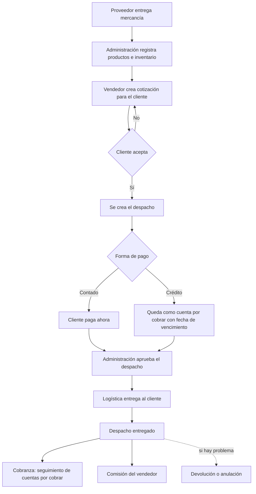

# Mapa del negocio: quién hace qué, de la compra a la entrega

**Fecha:** 2026-11-07 · **Tipo:** documentación (no cambia nada del sistema) · **Caso:** OP-2026-015

## En resumen

- El sistema sigue el recorrido real de un pedido: **se compra la mercancía, se cotiza al cliente, el cliente paga, administración aprueba el despacho y logística lo entrega**.
- Cada paso lo hace una persona con un **rol** distinto, y el sistema solo deja que cada rol vea y haga lo que le toca.
- El diagrama de abajo es la vista general. Para cada paso importante hay un detalle aparte si hace falta (cobro a crédito, comisiones, devoluciones).

## Glosario en palabras simples

- **Cotización:** oferta de precios que el vendedor le manda al cliente antes de vender.
- **Despacho:** la salida de mercancía. Es lo que se factura, se cobra y se entrega.
- **Nota de entrega / orden de despacho:** los papeles en PDF que acompañan el despacho.
- **Cuenta por cobrar (CxC):** dinero que el cliente debe pagar después (venta a crédito).
- **Comisión:** porcentaje que gana el vendedor por una venta.
- **Rol:** el cargo con el que alguien entra al sistema. Define qué puede ver y qué puede hacer.

## Roles

| Rol (nombre en el sistema) | Quién es | Qué puede hacer, en general |
|---|---|---|
| `jefe` | Dueño / dirección | Ve todo de la empresa: ventas, comisiones, equipo, auditoría. |
| `administracion` | Administración | Aprueba despachos, maneja cobros y cuentas por cobrar, inventario y operaciones. |
| `supervisor` | Supervisor de ventas | Ve y maneja las ventas de su equipo y sus propios clientes. |
| `vendedor` | Vendedor | Sus propios clientes y cotizaciones; gana comisión. |
| `vendedor_sin_comision` | Venta de empresa | Hace ventas que no generan comisión. |
| `logistica` | Logística / chofer | Ve los despachos por entregar y registra la entrega. |
| `desarrollador` | Soporte técnico | Acceso técnico al sistema. |

## Diagrama general del recorrido

## Qué pasa en cada paso

1. **Compra y registro de mercancía:** administración carga los productos y sus precios al inventario.
2. **Cotización:** el vendedor arma la cotización con los productos y precios. Si el cliente no acepta, se ajusta y se vuelve a cotizar.
3. **Despacho:** cuando el cliente acepta, la cotización se convierte en un despacho con su forma de pago.
4. **Cobro:** si es de contado, el cliente paga en el momento. Si es a crédito, el sistema calcula la fecha de vencimiento (ver el caso de vencimiento en despachos).
5. **Aprobación:** administración revisa y aprueba el despacho antes de que salga.
6. **Entrega:** logística ve el despacho como "por entregar", lo entrega y lo marca como entregado.
7. **Después de entregar:** se revisan las cuentas por cobrar, se calculan las comisiones y, si hubo un problema, se hace una devolución o anulación.

## Estados de un despacho

Según el sistema, un despacho pasa por estos estados: **Pendiente → Por entregar → Entregada**. También puede quedar **Anulada**.

## Qué tienes que hacer tú

Nada en este documento requiere acción. Sirve como referencia para entender el sistema y para explicarlo a personal nuevo.

## Cómo se mantiene

Si cambia un rol o un paso del recorrido, este documento se actualiza en el mismo cambio. Ver la ley de documentación en `AGENTS.md`.
