# OP-2026-067 — Auditoría de lógica y flujos completos del inventario (E2E) + diagrama de flujo

**Fecha:** 24 de noviembre de 2026 · **Tipo:** revisión (auditoría de código y datos reales, solo lectura) · **Caso:** `OP-2026-067`
**Alcance:** catálogo de productos, ficha de edición, ingresos y egresos manuales, carga masiva (Excel / lote), transformaciones (cortes), reversiones en el Kardex, cotizaciones, creación/aprobación/entrega/reapertura/anulación/edición profunda de despachos, devoluciones parciales e intercambios, préstamos de mercancía, órdenes de compra, proveedores (cuentas por pagar), respaldos y permisos en la base de datos.
**Cambios hechos:** ninguno. Todo se comprobó leyendo el código actual y consultando la base de datos de producción en modo **solo lectura** (`oyfyuszgjwcepjpngclv`).

## En resumen

- **La buena noticia (el día a día de ventas SÍ funciona):** desde el cambio del 19 de octubre de 2026 —cuando el sistema empezó a descontar la mercancía al **aprobar** el despacho y no al entregarlo—, los **632 despachos** recientes tienen **0 diferencias** entre sus artículos y el Kardex (el libro diario de entradas y salidas de mercancía). Además, en los `7.955` movimientos históricos del Kardex hay **0 errores de suma interna**, y las existencias actuales de los `403` productos con historial coinciden exactamente con su último movimiento registrado.
- **Por qué el inventario NO está exacto hoy:** por dos razones que se suman:
  1. **10 fallas activas en el programa (`N25` a `N34`)** — 4 graves, 4 importantes y 2 menores — que rompen el conteo cuando ocurren situaciones reales (por ejemplo: editar el precio de un producto con la pantalla desactualizada, revertir una devolución desde el Kardex, prestar mercancía, reabrir un despacho con devoluciones hacia "aprobado", o reintentos de red sin clave única).
  2. **Arrastre histórico y operación sin conteo físico de arranque:** `158` productos nacieron con stock antes de que existiera el Kardex, `37` productos arrastran `61` "saltos" antiguos en el historial (casi todos de mayo a julio de 2026), `4` productos tienen stock negativo sin ningún movimiento en su Kardex, y hoy hay **24 productos en negativo** (hasta `-394` unidades) porque el sistema nunca frena ventas por falta de stock y las compras a proveedores no cargan inventario automáticamente.
- **Qué hacer ahora:** primero cerrar las **fallas de código** en **staging** (la copia de pruebas), empezando por las 4 graves (`N25`–`N28`), y **después** hacer un conteo físico de arranque (empezando por los 24 productos en negativo y los de mayor rotación) para dejar el almacén cuadrado al 100%.

---

## 1. Mapa y diagrama de flujo completo del inventario

Hoy el sistema sigue estas reglas básicas:
- **Cotizar o crear un despacho ("pendiente") NO mueve el inventario.** La mercancía sigue disponible hasta que administración aprueba la salida.
- **Aprobar el despacho (`pendiente → despachada`) SÍ descuenta el inventario** de una vez (y si no alcanza, igual deja pasar la venta marcando el stock en negativo y guardando una alerta). Entregar (`despachada → entregada`) ya no descuenta nada (salvo si se entrega directo desde `pendiente` sin pasar por aprobación).
- **Devolver un despacho a pendiente o anularlo desde `despachada` o `entregada` regresa la mercancía al inventario**, igual que una devolución parcial.

```mermaid
flowchart TD
    subgraph CAT["1. Catalogo y ajustes manuales"]
        C1["Crear producto con stock inicial"] -->|"Suma (+)"| K["Stock actual + Kardex"]
        C2["Editar ficha del producto (FALLA N25: pisa stock viejo)"] -->|"Ajuste (+/-)"| K
        C3["Ingreso / Egreso manual por lote"] -->|"Suma (+) / Resta (-)"| K
        C4["Ingreso masivo Excel / lote (sumar o sobrescribir)"] -->|"Suma (+) o Pisa"| K
        C5["Transformacion / Corte (ej. cabilla 12m a 6m)"] -->|"Resta origen (-) / Suma destino (+)"| K
        C6["Revertir movimiento en Kardex (FALLA N26: permite romper devoluciones y cortes)"] -->|"Movimiento inverso"| K
        C7["Borrar producto definitivamente (FALLA N33)"] -->|"Egreso a 0 y borra enlace"| K
    end

    subgraph VENTA["2. Ciclo de venta y despacho"]
        V1["Cotizacion (borrador / enviada / aceptada)"] -.->|"NO toca stock"| V2
        V2["Crear despacho (estado: pendiente)"] -.->|"NO toca stock"| V3
        V3["Aprobar despacho (pendiente -> despachada)"] -->|"Resta (-) siempre, permite negativo"| K
        V3 --> V4["Entregar despacho (despachada -> entregada)"]
        V4 -.->|"NO toca stock (ya salio al aprobar)"| V5["Despacho entregado"]
        V2 -->|"Entrega directa (pendiente -> entregada)"| K
        V3 -->|"Edicion profunda en despachada (FALLA N28)"| K
        V3 -->|"Devolver a pendiente o Anular (FALLA N28)"| K
        V5 -->|"Devolucion parcial / Intercambio (FALLA N31)"| K
        V5 -->|"Revertir entrega a despachada"| V3
        V5 -->|"Reabrir a pendiente o Anular"| K
    end

    subgraph PREST["3. Prestamos de mercancia"]
        P1["Item marcado como Prestamo en despacho (FALLA N27)"] -.->|"HOY NO resta stock"| P2["Prestamo activo del cliente"]
        P2 -->|"Devolver prestamo fisico"| K
        P2 -->|"Facturar prestamo a deuda"| P3["Solo crea deuda CxC (NO resta stock)"]
    end

    subgraph NOTOCA["4. Flujos que NO tocan inventario"]
        N1["Ordenes de compra y Proveedores (CxP)"] -.->|"Desconectado: hay que cargar ingreso aparte"| K
        N2["Pagos, abonos, CxC, descuentos y comisiones"]
        N3["Editar pago, chofer, flete o codigos externos"]
        N4["Articulos externos (sin producto de inventario)"]
    end
```

### Tabla resumen: ¿qué toca el inventario en todo el sistema?

| Flujo / Pantalla | ¿Cambia `stock_actual` y Kardex? | Cuándo y cómo lo hace | Estado / Falla detectada |
|---|---|---|---|
| **Crear producto** (manual o importador CSV) | **Sí** (si stock inicial > 0) | Suma el stock inicial en una sola operación (`crear_producto_con_kardex_tenant_safe`). | Bien |
| **Editar ficha de producto** (precio, nombre, foto, stock) | **Sí** (aunque no toques el stock) | Compara el stock que tenía la pantalla al abrirse contra la BD y crea un ajuste por la diferencia (`actualizar_producto_con_kardex_tenant_safe`). | 🔴 **Falla N25** |
| **Cambiar foto, activar/desactivar, peso o activar precio 2/3** | **No** | Solo actualiza metadatos del producto (`/api/productos/metadatos`). | Bien |
| **Actualización masiva de precios** (y restaurar lote) | **No** | Solo cambia precios de venta (`aplicar_lote_precios`). | Bien |
| **Ingreso / Egreso manual por lote** | **Sí** | Suma o resta una lista de productos con motivo (`aplicar_movimiento_inventario_atomico`). | Bien |
| **Ingreso masivo por lote (Excel / OCR)** | **Sí** (puede sumar o sobrescribir) | Crea productos nuevos y suma o pisa existencias de productos existentes (`ingresar_lote_inventario_atomico`). No pisa precios de existentes. | 🟠 **Falla N29** (sin clave única desde pantalla) · 🟡 **N34** (duplicados en mismo lote) |
| **Transformación / Corte** (ej. cabilla 12m → 6m) | **Sí** | Resta producto origen y suma producto destino en el mismo lote (`transformar_inventario_atomico`). | 🟠 **Falla N29** (sin clave única desde pantalla) |
| **Revertir movimiento en Kardex** | **Sí** | Crea un movimiento inverso (`revertir_movimiento_inventario_atomico`). | 🔴 **Falla N26** |
| **Borrar producto definitivamente** | **Sí** (si stock ≠ 0) | Registra salida en Kardex y elimina la fila del producto (`borrar_producto_con_kardex_tenant_safe`). | 🟡 **Falla N33** |
| **Cotizaciones** (crear, editar, borrar, vencer) | **No** | Solo precios y cantidades ofertadas. | Bien |
| **Crear despacho** (`pendiente`) | **No** | Copia artículos de la cotización a `notas_despacho_items`. | Bien |
| **Aprobar despacho** (`pendiente → despachada`) | **Sí** (resta) | Resta artículos propios de inventario (`es_prestamo = false`), siempre permite stock negativo y guarda alertas (`aprobar_despacho_inventario_atomico`). | 🔴 **Falla N27** (excluye préstamos) · 🟠 **N29** |
| **Confirmar entrega** (`despachada → entregada`) | **No** (normalmente) | Solo cambia estado y finanzas; únicamente descuenta si el despacho estaba en `pendiente` (entrega directa). | 🔴 **Falla N27** (en entrega directa) · 🟠 **N29** |
| **Devolver a pendiente / Anular** desde `despachada` | **Sí** (suma) | Reingresa el 100% de artículos de inventario (`revertir_despacho_inventario_atomica`). | 🔴 **Falla N28** (si vino de `entregada` con devoluciones) · 🟡 **N33** |
| **Revertir entrega** (`entregada → despachada`) | **No** | Mantiene la mercancía fuera porque salió al aprobar. | 🔴 **Falla N28** (deja devoluciones vivas en estado `despachada`) |
| **Reabrir / Anular** desde `entregada` a `pendiente` o `anulada` | **Sí** (suma neto) | Reingresa artículos originales menos devoluciones + intercambios menos devoluciones (`revertir_entrega_inventario_atomica`). | 🟠 **Falla N31** (2 intercambios del mismo producto) · 🟡 **N33** |
| **Edición profunda de artículos** (`pendiente` vs `despachada`) | En `pendiente`: **No** · En `despachada`: **Sí** (diferencia) | Compara mapa viejo vs mapa nuevo y aplica la diferencia en `despachada` (`editar_despacho_profundidad`). | 🔴 **Falla N28** (si había devoluciones absorbidas) |
| **Devolución parcial / Intercambio** (en `entregada`) | **Sí** (+ devuelto, − intercambio) | Suma lo devuelto y resta lo entregado en intercambio (`registrar_devolucion_inventario_atomica`). | 🟠 **Falla N29** (sin clave única desde pantalla) · **N31** |
| **Devolución física de préstamo** | **Sí** (suma) | Suma de vuelta la cantidad devuelta (`devolver_prestamo_inventario_atomico`). | 🔴 **Falla N27** (suma lo que al salir no restó) |
| **Facturar préstamo** | **No** | Solo crea cargo en Cuentas por Cobrar (`handleFacturarPrestamo`). | 🔴 **Falla N27** |
| **Órdenes de compra y Proveedores (CxP)** | **No** | Solo registra orden de compra o deuda con el proveedor; hay que cargar el ingreso aparte en Inventario. | 🟠 **Falla N32** |
| **Artículos externos / Descuentos / Editar pago, chofer o flete / Abonos CxC / Comisiones** | **No** | Operaciones financieras, logísticas o de líneas sin código de inventario. | Bien |

---

## 2. Hallazgos: 10 fallas nuevas en el código (`N25` a `N34`)

> Las fallas se numeran siguiendo el [Registro de fallas del código](REGISTRO-FALLAS-CODIGO.md), que llegaba hasta `N24`.

### 🔴 Graves (crean mercancía fantasma o borran ventas y compras reales)

#### **N25 — Editar cualquier dato de un producto sobrescribe el stock con un número viejo ("pantalla desactualizada")**
- **Dónde:** `src/components/inventario/ProductoForm.jsx` (líneas 210 y 544) y `src/hooks/useInventario.js` (línea 365).
- **Qué pasa (analogía simple):** es como abrir una ficha de papel que dice "quedan 31 sacos de cemento", tardarse unos minutos en cambiarle el precio (o tener la lista abierta sin recargar) y, mientras tanto, el cajero vende 5 sacos (quedan 26). Cuando administración guarda el nuevo precio, el sistema también reescribe el inventario con el "31" que tenía en la pantalla y anota un falso `"Ajuste de stock al editar producto"` por `+5`. **La venta de esos 5 sacos desaparece del conteo.**
- **Qué se vio en producción:**
  - Hay **262** movimientos de `"Ajuste de stock al editar producto"` en la historia (**61** en los últimos 60 días y **43** en los últimos 30 días).
  - En **19 ocasiones**, esa edición devolvió el producto al número **exacto** previo a un movimiento reciente. Ejemplos reales:
    - `MOV-6544` (15-oct-2026): **26 segundos** después de entregarse el Despacho `#3977` (5 sacos de `CEMENTO GRIS ENSACADO`), una edición de ficha devolvió el stock de `26 → 31`.
    - `MOV-5614` (24-sep-2026): una edición borró de golpe **1.200 láminas** (`LAM. PREPINTADO ROJO (ZINC) 0,17 X 800 X 3,00 MTS`) que acababan de ingresar por `COMPRA ACERO METALES GUIA 2277` (`1.200 → 0`).
    - `MOV-4312` (27-ago-2026): **46 segundos** después de `AJUSTE INVENTARIO NIKI` (`+41` tubos), una edición devolvió el stock de `227 → 186`.
  - Además, en **23 ocasiones** (**15** desde el 19-oct, sumando **1.298 unidades**), un producto que estaba en negativo por ventas anticipadas fue puesto manualmente en `0` desde la ficha, borrando la señal de que faltaba cargar la compra correspondiente.

#### **N26 — El botón "Revertir" del Kardex deja deshacer devoluciones de despachos, mitades de cortes y hasta reversiones ya hechas**
- **Dónde:** `src/hooks/useMovimientosInventario.js` (línea 58), `src/components/inventario/KardexModal.jsx` (líneas 55 y 197–203) y `supabase/migrations/275_revertir_movimiento_inventario.sql` (líneas 91–102).
- **Qué pasa:**
  1. Para saber si un movimiento es manual (y mostrarle el botón "Revertir"), la pantalla del Kardex revisa `m.origen_tipo` y si ya fue revertido. Pero la consulta a la base de datos **no pide `origen_tipo` ni `origen_id`**. Como llegan vacíos, **el botón "Revertir" aparece en casi todas las filas** (incluyendo devoluciones de despachos, devoluciones de préstamos, cortes/transformaciones y reversiones anteriores), y la etiqueta "Revertida" nunca se ve.
  2. En la base de datos, la función `revertir_movimiento_inventario_atomico` solo bloquea el tipo `venta`, dejando pasar `devolucion` y `transferencia`. Tampoco verifica si el movimiento original nació de una devolución de despacho o de un corte, ni bloquea la fila original contra dos clics simultáneos, y permite revertir una reversión indefinidamente.
- **Qué se vio en producción:** de las **9 reversiones** registradas en toda la historia, **5 fueron sobre operaciones que no debían tocarse desde el Kardex**:
  - El 6-nov-2026 (`MOV-7649` y `MOV-7650`) se revirtió la devolución parcial del Despacho `#4161` (`-1.510` cabillas de 16mm × 6m) y luego se revirtió la propia reversión (`+1.510`).
  - El 22-oct-2026 (`MOV-6985` y `MOV-6987`) se revirtieron por separado piezas sueltas de `CORTE PARA LA VENTA` (`-1.080` de 12mm × 6m y `+540` de 10mm × 12m), rompiendo la pareja del corte.

#### **N27 — Los préstamos de mercancía ya NO descuentan inventario al salir, pero SÍ lo suman al devolverse (regresión del 19-oct)**
- **Dónde:** `supabase/release/main/17_egreso_inventario_aprobacion_apply.sql` (`aprobar_despacho_inventario_atomico` línea 118, `confirmar_entrega_inventario_atomica` línea 322, `revertir_entrega_inventario_atomica` línea 507, `revertir_despacho_inventario_atomica` línea 668, `editar_despacho_profundidad` líneas 920 y 1006), `supabase/release/main/02_inventory_atomic_operations.sql` (`devolver_prestamo_inventario_atomico` líneas 532–551) y `api/handlers/clientes.js` (`handleFacturarPrestamo` líneas 798–925).
- **Qué pasa:** antes de octubre, cuando un artículo salía como préstamo (`es_prestamo = TRUE`), salía del almacén al entregar y volvía a entrar cuando el cliente lo devolvía físicamente. Con el cambio del 19 de octubre (Release 17), todas las funciones de despacho excluyeron `es_prestamo = FALSE`. Sin embargo, el flujo de **devolver préstamo** siguió sumando stock (`+cantidad`) y **facturar préstamo** solo crea deuda en dinero sin restar mercancía.
- **Daño:** si hoy sale un préstamo nuevo, **no baja del almacén**. Si luego el cliente lo devuelve, el sistema lo vuelve a sumar (**creando mercancía fantasma**). Si el cliente se lo queda y se le factura, la mercancía **nunca se descuenta**.
- **Qué se vio en producción:** los `4` préstamos activos hoy (`#665`, `#692`, `#1648`, entre ellos `400` unidades de `ALAMBRE GALVANIZADO CALIBRE 18`) son de mayo–julio y sí descontaron en su momento (los `4` siguen con `0` devuelto y `0` facturado). La bomba está armada para el próximo préstamo.

#### **N28 — Reabrir un despacho entregado con devoluciones hacia "aprobado" (`despachada`) y luego anularlo, devolverlo a pendiente o editarlo duplica devoluciones y pierde intercambios**
- **Dónde:** `supabase/release/main/17_egreso_inventario_aprobacion_apply.sql` (`revertir_entrega_inventario_atomica` línea 482, `revertir_despacho_inventario_atomica` línea 658, `editar_despacho_profundidad` líneas 911–1075) y `api/handlers/despachos.js` (`retirarDevolucionesAbsorbidas` líneas 1890 y 1935–1978).
- **Qué pasa:** si un despacho entregado ya tuvo una devolución parcial (ej. el cliente devolvió 30 láminas y se llevó 30 de intercambio) y luego alguien lo revierte a `despachada` (`entregada → despachada`):
  1. El stock queda igual (correcto), pero las tablas `despacho_devoluciones` y `despacho_devolucion_intercambios` siguen vivas.
  2. Si luego alguien pasa ese despacho de `despachada → pendiente` o `anulada`, la función `revertir_despacho_inventario_atomica` asume que *"no hay devoluciones previas"* y **vuelve a sumar el 100% de las líneas originales** (doble ingreso de lo ya devuelto) y **no reingresa las láminas de intercambio** (mercancía perdida en el Kardex).
  3. Y si alguien hace una **Edición profunda** estando en `despachada`, el sistema compara lo nuevo contra los ítems originales sin restar lo ya devuelto/intercambiado, y al final borra el libro de devoluciones: **duplica el efecto en el inventario**.
- **Qué se vio en producción:** en los 2 casos donde se retiraron devoluciones (`#4534` el 5-nov y `#4279` el 26-oct), el operador pasó primero a `pendiente` y esquivó el fallo, pero el camino roto sigue abierto.

---

### 🟠 Importantes (pueden duplicar movimientos, romper intercambios o dejar puertas abiertas)

#### **N29 — Cuatro flujos de inventario no envían la "huella única" (`Idempotency-Key`) desde la pantalla**
- **Dónde:** `src/hooks/useDespachos.js` (`useActualizarEstadoDespacho` línea 402 y `useDevolucionParcialDespacho` línea 636), `src/components/inventario/IngresoLoteHubModal.jsx` (línea 467) y `src/components/inventario/ModalTransformacion.jsx` (línea 64).
- **Qué pasa:** la base de datos ya tiene protección contra envíos repetidos (si llega la misma huella dos veces por mala señal o doble clic, la segunda vez no hace nada). Pero estas 4 pantallas no envían la huella, así que el servidor (`resolverIdempotencyKey`) inventa una huella nueva en cada reintento automático de red.
- **Daño:** si se corta internet justo al confirmar una devolución parcial, un ingreso masivo o una transformación (corte), el reintento puede aplicar el movimiento **dos veces**. (En producción vimos un posible síntoma previo en `#4778` el 16-nov, donde la aprobación se registró dos veces con 45 segundos de diferencia tras una devolución a pendiente en el medio.)

#### **N30 — Tres funciones viejas que tocan inventario siguen abiertas al público en la base de datos**
- **Dónde:** base de datos de producción (`aplicar_movimiento_lote`, `actualizar_estado_despacho` y `reciclar_despacho` tienen permiso `EXECUTE` para `PUBLIC`, `anon` y `authenticated`, además con permisos de dueño `SECURITY DEFINER`); y las tablas `notas_despacho_items` y `cliente_prestamos` permiten escritura directa a `authenticated`.
- **Lo bueno:** las tablas `productos` e `inventario_movimientos` sí están cerradas (solo lectura directa; nadie puede escribir sin pasar por el servidor).
- **Riesgo:** aunque la pantalla normal no usa esas funciones viejas, cualquiera que consulte la base de datos por fuera de la aplicación podría ejecutarlas.

#### **N31 — Dos intercambios del mismo producto en un despacho se descuentan doble al reabrir**
- **Dónde:** `supabase/release/main/17_egreso_inventario_aprobacion_apply.sql` (`revertir_entrega_inventario_atomica`, líneas 511–525) y `api/handlers/despachos.js` (líneas 2298–2308).
- **Qué pasa:** si en un despacho se hacen dos intercambios distintos en fechas distintas agregando el mismo producto, y luego el cliente devuelve parte de ese producto, al reabrir el despacho la consulta resta el total devuelto a cada fila de intercambio por separado en lugar de sumar las filas primero. Además, la validación del servidor solo revisa la primera fila del intercambio.

#### **N32 — Órdenes de compra y Proveedores (CxP) desconectados del inventario, y respaldo/restauración incompleto**
- **Dónde:** `src/hooks/useOrdenesCompra.js`, `api/handlers/proveedores.js` y `api/handlers/admin.js` (`handleBackup` línea 286, `handleRestore` línea 391, `handleResetOperacional` línea 775).
- **Qué pasa:**
  1. Hoy no hay órdenes de compra usadas (`0` registros), pero aprobar una orden de compra o registrar una factura por pagar a un proveedor **no suma nada al almacén**: obliga a cargar otro ingreso manual aparte en Inventario. Si se olvida cargarlo, el producto cae en negativo al vender; si se carga dos veces (como pasó el 14-sep en `MOV-5118/5119` `"INGRESO PEDIDO DOS VECES"`), el stock se infla.
  2. El botón de respaldo/restauración en JSON dentro del panel de administración **no respalda ni restaura `inventario_movimientos` ni `cliente_prestamos`**. Si alguna vez se restaura ese respaldo, cambia `productos.stock_actual` sin dejar rastro en el Kardex.

---

### 🟡 Menores y de borde

#### **N33 — Borrar un producto rompe el enlace en despachos viejos; desactivarlo impide revertir despachos**
- **Dónde:** `supabase/release/main/05_inventory_guardrails_and_reconciliation.sql` (`borrar_producto_con_kardex_tenant_safe`, líneas 324–343) y `supabase/release/main/17_egreso_inventario_aprobacion_apply.sql` (líneas 538 y 679).
- **Qué pasa y qué se vio en producción:**
  1. **10 productos borrados** en producción dejaron **678 líneas de despacho** (`origen = 'inventario'`) y **782 filas de Kardex** sin `producto_id` (`NULL`). Si alguno de esos despachos viejos se anula, se reabre o recibe una devolución, su stock **no puede regresar**.
  2. Si un producto tiene stock negativo y se borra, el Kardex anota `'egreso'` en vez de `'ingreso'` al llevarlo a `0`.
  3. Si un producto solo se **desactiva** (`activo = false`), las funciones de revertir/anular despacho fallan con `"PRODUCTO_NO_DISPONIBLE"` y no dejan reingresar la mercancía.

#### **N34 — Recorte a 2 decimales en despachos, filas repetidas en Excel y sin vigilante nocturno de inventario**
- **Dónde:** `17_egreso_inventario_aprobacion_apply.sql` (variables `NUMERIC(10,2)`/`NUMERIC(12,2)` frente a `NUMERIC(12,4)` en `productos.stock_actual`), `279_batch_ingest_no_pisa_precios.sql` (no agrupa si el mismo producto viene repetido en dos líneas del mismo archivo) y `scripts/auditor-saldos-main.mjs` (el vigilante nocturno revisa CxC y Comisiones, pero no revisa Inventario).

---

## 3. Radiografía real del inventario hoy en producción (24-nov-2026)

| Indicador revisado (solo lectura) | Resultado real hoy | Lectura en palabras simples |
|---|---|---|
| **Productos en catálogo** | `477` activos · `1` inactivo | 478 productos en total |
| **Movimientos en el Kardex** | `7.955` movimientos | **0 errores de suma interna** en cada fila |
| **Productos donde `stock_actual` = último movimiento del Kardex** | `403` de `403` con historial (`0` diferencias) | El motor de Kardex sí guarda exactamente lo que calcula |
| **Productos con cadena 100% limpia desde cero** | `238` de `403` (`59%`) | Nacieron en 0 y cada movimiento enlaza con el anterior |
| **Productos que nacieron con stock antes del Kardex** | `158` productos | Empezaron con existencias sin asiento inicial en Kardex |
| **Saltos antiguos en la cadena del Kardex** | `61` saltos en `37` productos | `58` de mayo–julio, `2` de agosto, `1` de octubre (`+30` en *Tubo Red Vent 3/4* el 28-oct) |
| **Productos con stock ≠ 0 y 0 movimientos en Kardex** | `4` productos (`-57`, `-24`, `-13`, `-5`) | De mayo 2026, sin registro de salida ni entrada |
| **Productos en stock negativo hoy** | **`24` productos** | Ej.: Alambre Galv. Cal 18 (`-394`), Cabilla 12mm Sidor (`-100`), Cabilla 20mm Sidetur (`-70`), Curva Conduit 1/2" (`-57`), Clavo Acero 2" (`-43`) |
| **Despachos desde el 19-oct-2026 vs Kardex** | **`632` despachos · `0` con diferencia** | Desde que se descuenta al aprobar, el flujo de despacho cuadra al 100% |
| **Despachos viejos (mayo–septiembre) con diferencia** | `3` en `despachada` (`71` und) · `4` anulados · `29` entregados | Arrastre del modelo viejo antes de octubre (`#1930`, `#1933`, `#2144` siguen sin entrega desde jul/ago) |
| **Préstamos activos** | `4` pendientes (mayo–julio) | `400` Alambre Cal 18, `27` Losacero, `15` Tubo Estruc., `1` Cercha |
| **Órdenes de compra cargadas** | `0` órdenes | Módulo aún sin uso |

---

## 4. Plan recomendado para arreglarlo (en orden)

> Regla de oro: todo cambio de programa o base de datos se prueba **primero en staging** (copia de pruebas) y solo después pasa a producción. Y **el conteo físico de arranque se hace después de tapar los agujeros**, no antes (si no, el sistema vuelve a descuadrar lo que contaste).

| Fase | Qué arreglar | Falla que tapa | Riesgo |
|---|---|---|---|
| **1. Frenar los descuadres diarios** (urgente) | 1) En la ficha de editar producto (`ProductoForm`), **no enviar ni pisar `stock_actual`** al editar precio/nombre/foto (los ajustes de stock se hacen por "Ingreso/Egreso de inventario", o con un botón aparte que compare contra el stock real en el servidor). 2) En el Kardex (`useKardex` + `revertir_movimiento_inventario_atomico`), traer `origen_tipo` y **bloquear reversiones** sobre devoluciones, préstamos, transformaciones y reversos de reversos. | `N25`, `N26` | Bajo |
| **2. Corregir préstamos y reapertura de despachos** (urgente) | 1) Decidir con el dueño la regla de **préstamos**: lo sano es que descuenten stock al aprobar/entregar como cualquier salida física, y al facturar no toquen stock. 2) Hacer que `revertir_despacho_inventario_atomica` y `editar_despacho_profundidad` descuenten devoluciones/intercambios previos (o impedir pasar `entregada → despachada` si el despacho tiene devoluciones). Corregir agrupación por producto en intercambios. | `N27`, `N28`, `N31` | Medio |
| **3. Blindar contra duplicados y puertas traseras** | 1) Enviar `Idempotency-Key` estable desde las 4 pantallas que faltan. 2) Quitar permisos de ejecución a `PUBLIC/anon/authenticated` de las 3 funciones viejas (`aplicar_movimiento_lote`, `actualizar_estado_despacho`, `reciclar_despacho`) y cerrar escrituras directas en `notas_despacho_items` y `cliente_prestamos`. | `N29`, `N30` | Bajo |
| **4. Higiene de catálogo y vigilante nocturno** | 1) Impedir borrar físicamente productos que ya tengan despachos o Kardex (solo desactivar), permitir que devoluciones/anulaciones reingresen productos desactivados, y corregir el signo al borrar con negativo. 2) Unificar 4 decimales, sumar filas repetidas en lote Excel, y agregar sección de **Inventario** al vigilante nocturno (`auditor-saldos-main.mjs`). | `N33`, `N34` | Bajo |
| **5. Limpieza de datos + conteo físico de arranque** (con el equipo en almacén) | 1) Revisar los `3` despachos viejos atascados en `despachada` (`#1930`, `#1933`, `#2144`) y los `4` préstamos viejos (`#665`, `#692`, `#1648`). 2) Hacer conteo físico empezando por los **24 productos en negativo** y los de mayor rotación (cabillas, cemento, alambre, láminas, tubos), y cargar un ajuste único con motivo `"Conteo físico de arranque"`. | Arrastre histórico | Operativo |
| **6. Decisión de negocio (opcional)** | Decidir si al recibir mercancía de un proveedor / orden de compra se quiere un botón `"Recibir compra en inventario"` para evitar olvidar cargas de stock o cargarlas dos veces. | `N32` | Bajo |

---

## 5. Cómo se comprobó y qué queda pendiente

### Cómo se comprobó
- **Código revisado:** `api/handlers/inventario.js`, `api/handlers/despachos.js`, `api/handlers/clientes.js`, `api/handlers/proveedores.js`, `api/handlers/admin.js`, `worker.js`, `src/hooks/useInventario.js`, `src/hooks/useMovimientosInventario.js`, `src/hooks/useDespachos.js`, `src/hooks/useOrdenesCompra.js`, `src/components/inventario/ProductoForm.jsx`, `src/components/inventario/KardexModal.jsx`, `src/components/inventario/ModalTransformacion.jsx`, `src/components/inventario/IngresoLoteHubModal.jsx`, `src/components/inventario/ImportadorModal.jsx`, `src/components/despachos/EditarItemsDespachoModal.jsx`.
- **Scripts de base de datos revisados:** `supabase/release/main/01_kardex_provenance.sql`, `02_inventory_atomic_operations.sql`, `04_idempotency_wrappers.sql`, `05_inventory_guardrails_and_reconciliation.sql`, `17_egreso_inventario_aprobacion_apply.sql`, `supabase/migrations/163_add_prestamos_tables.sql`, `225_devolucion_parcial_inventario_atomica.sql`, `232_revertir_entrega_finanzas_atomica.sql`, `275_revertir_movimiento_inventario.sql`, `279_batch_ingest_no_pisa_precios.sql`, `305_despacho_pagos_al_reabrir_anular.sql`, `306_edicion_profunda_cxc.sql`.
- **Base de datos de producción (`oyfyuszgjwcepjpngclv`):** consultas de solo lectura ejecutadas el 24-nov-2026 sobre `productos`, `inventario_movimientos`, `notas_despacho`, `notas_despacho_items`, `despacho_devoluciones`, `despacho_devolucion_intercambios`, `cliente_prestamos`, `ordenes_compra`, `configuracion_negocio`, `auditoria`, triggers, funciones activas y permisos de tablas/funciones.

### Pendiente / requiere confirmación del dueño
- **No se aplicó ningún cambio** ni en staging ni en producción.
- Confirmar si quieres que empecemos con la **Fase 1 y Fase 2 en staging**, y confirmar estas 2 decisiones de negocio:
  1. **Editar stock desde la ficha del producto (`N25`):** ¿quitamos el campo de stock de la ficha de edición para que todo cambio de existencia pase por `"Ingreso / Egreso de inventario"`, o prefieres dejarlo con un botón aparte que primero pida motivo y valide que nadie lo haya movido mientras tanto?
  2. **Préstamos (`N27`):** ¿confirmas que un artículo marcado como préstamo debe **salir del inventario al aprobar el despacho** (igual que una venta física) y solo volver a entrar si el cliente lo devuelve físicamente?

---

## 6. Actualización y comprobación en staging ([OP-2026-068](OP-2026-068_simulacion-fallas-inventario-staging.md))

- En la revisión minuciosa posterior (Venta Rápida, Devolución Parcial y movimientos por lote) se descubrió una **onceava falla grave (`N35`)**: devolver un artículo marcado como préstamo desde "Devolución parcial" en un despacho mixto acredita saldo a favor gratis (`+$50` en prueba) y permite devolverlo dos veces (`+6` unidades fantasma).
- Todas las fallas (`N25`–`N31`, `N33`–`N35`, además de `N32` en código) quedaron **reproducidas y confirmadas en staging** con `0` registros residuales en [OP-2026-068](OP-2026-068_simulacion-fallas-inventario-staging.md).
